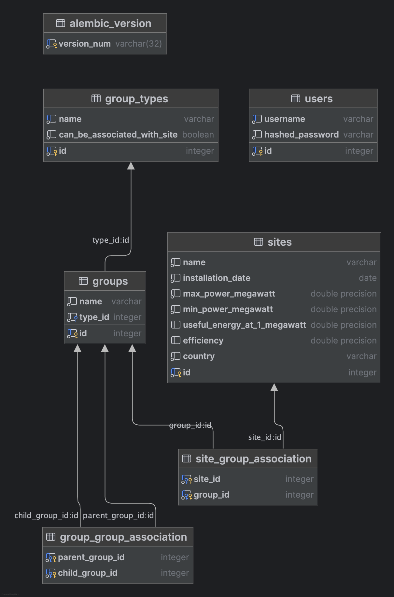

python-technical-test
======================

This project manages data related to **Sites** and **Groups**, allowing flexible associations and country-specific business logic.

Overview
--------

Sites represent individual installations with technical parameters, while Groups organize these sites by shared characteristics. Each group can contain multiple sites or subgroups (recursive). Country-specific logic applies to sites in France and Italy, with extendibility for more.

Project Structure
-----------------

- FastAPI app with modular routers (`/sites`, `/groups`, `/group_types`, `/auth`)
- SQLAlchemy models with Alembic migrations
- JWT-based authentication
- Full CRUD, filtering, and sorting
- Test suite with Pytest
- Seed scripts for initial data
- Docker-ready setup

Business Rules
--------------

- **French Sites**:
  - Only one can be installed per day.
- **Italian Sites**:
  - Must be installed on weekends.
  - Use `efficiency` instead of `useful_energy_at_1_megawatt`.
- **Sites cannot be added to groups of type `group3`**

Data Model Overview
-------------------

This section describes the current database schema for the "python-technical-test" project, including each table and their relationships, followed by suggestions for future evolution.



1. Tables and Purpose
---------------------

- **alembic_version**  
  Tracks applied migration versions.

- **users**  
  - `id` (integer, PK)  
  - `username` (varchar, unique)  
  - `hashed_password` (varchar)  
  Stores application users.

- **group_types**  
  - `id` (serial, PK)  
  - `name` (varchar, unique)  
  - `can_be_associated_with_site` (boolean)  
  Defines types (e.g., “group1”, “group2”) and whether they are allowed on sites.

- **groups**  
  - `id` (serial, PK)  
  - `name` (varchar)  
  - `type_id` (integer, FK → group_types.id)  
  Represents organizational units that can contain sites or other groups.

- **group_group_association**  
  - `parent_group_id` (integer, FK → groups.id)  
  - `child_group_id` (integer, FK → groups.id)  
  Self-referential many-to-many: groups containing sub-groups.

- **sites**  
  - `id` (serial, PK)  
  - `name` (varchar)  
  - `installation_date` (date)  
  - `max_power_megawatt` (double precision)  
  - `min_power_megawatt` (double precision)  
  - `useful_energy_at_1_megawatt` (double precision, nullable)  
  - `efficiency` (double precision, nullable)  
  - `country` (varchar)  
  Records each installation; FR sites require `useful_energy_at_1_megawatt`, IT sites require `efficiency`.

- **site_group_association**  
  - `site_id` (integer, FK → sites.id)  
  - `group_id` (integer, FK → groups.id)  
  Many-to-many linking sites to groups.

2. Relationships
----------------

- **Sites ↔ Groups**: Many-to-many via **site_group_association**.
- **Groups ↔ Groups**: Recursive many-to-many via **group_group_association**.
- **Groups → GroupTypes**: Each group has one type.

3. Future Evolution & Best Practices
------------------------------------

To support growing requirements and maintain flexibility, consider:

- **Audit Fields**: Add `created_at`, `updated_at`, and `created_by_id` (FK → users.id) to track who and when data changes occur.
- **Soft Deletes**: Include a boolean `is_active` or `deleted_at` timestamp rather than hard-deleting rows.
- **Country‑Specific Configuration**: Instead of adding columns per country, introduce a `site_types` table and a generic JSON/`properties` column, or use table inheritance/polymorphic models, reducing code changes when new site types arrive.
- **Database‑Enforced Business Rules**: Implement database constraints or triggers for:  
  - Only one French site per day.  
  - Italian sites only on weekends.  
- **Modular Audit Logging**: Use an audit/logging extension (e.g., `pg_audit` or a separate history table) for comprehensive change tracking.

**Current Delivery**  
The provided schema uses direct columns for country-specific fields and enforces business logic at the application level. The above suggestions can be phased in as the product scales to reduce application code maintenance and improve data integrity.

Setup & Installation
--------------------

### Via Uvicorn (local dev)

1. Create virtual environment:
   ```
   python -m venv .venv
   source .venv/bin/activate
   ```

2. Install dependencies:
   ```
   pip install -r requirements.txt
   ```

3. Run migrations:

   ```
   cd app/
   ```

   ```
   alembic upgrade head
   ```

4. Seed initial data:
   ```
   python app/seed_user.py
   python app/seed_group_types.py
   ```

5. Run the API:
   ```
   uvicorn app.main:app --reload
   ```

### Via Docker

```
docker compose build --no-cache
```

```
docker compose up
```

API will be available at: `http://localhost:8000/docs`

Deleting pycache
------------------

```
find . -type d -name "__pycache__" -exec rm -r {} +
```

Running Migrations
------------------

Create:
```
alembic revision --autogenerate -m "migration message"
```

Apply:
```
alembic upgrade head
```

Reset:
```
rm app/infrastructure/migrations/versions/*.py
```

Testing
-------

Run all tests:
```
pytest
```

Test coverage includes:
- French/Italian site creation & validation
- Filtering, sorting, updating, and deleting sites/groups/group_types
- Auth and token validation
- Error handling for invalid inputs or constraints

Endpoints Summary
-----------------

### /auth
- `POST /auth/login` – Get token with username/password

### /sites
- `GET` – List sites (with filters/sorting)
- `POST` – Create site with validations
- `PATCH` – Update a site
- `DELETE` – Delete a site

### /groups
- `GET` – List groups (filter by name, sort)
- `POST` – Create group
- `PUT` – Update group
- `DELETE` – Delete group

### /group_types
- `GET` – List types
- `POST` – Create type (no duplicates)
- `PUT` – Update
- `DELETE` – Remove

Good Practices
--------------

- Structured modular layout (`routers`, `models`, `utils`, `db`)
- Pydantic validation at request layer
- Async SQLAlchemy sessions with FastAPI dependencies
- JWT token with expiration for security
- Clear naming & business logic encapsulation
- Strict test coverage before deployment

Developer Shortcuts
-------------------

- Run API: `make run` or `uvicorn app.main:app --reload`
- Seed DB: `python app/seed_user.py`, `app/seed_group_types.py`
- Format: `black . && isort .`
- Lint: `flake8 .`
- Test: `pytest`

Author
------

Developed as part of a technical test demonstrating best practices, robustness, and adaptability for future extensions.
